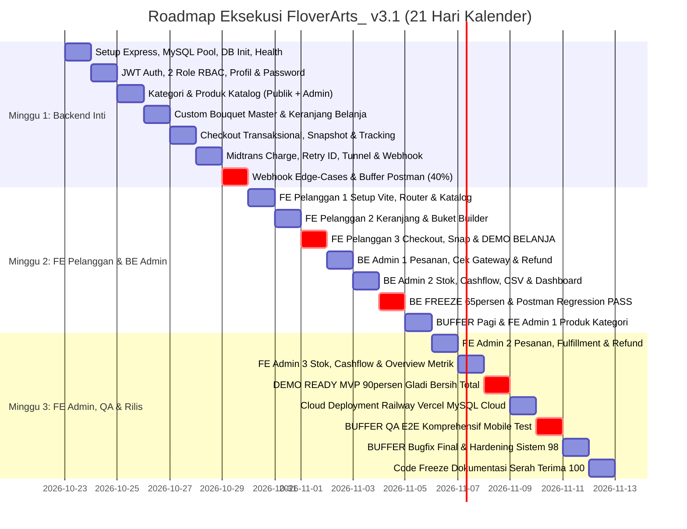
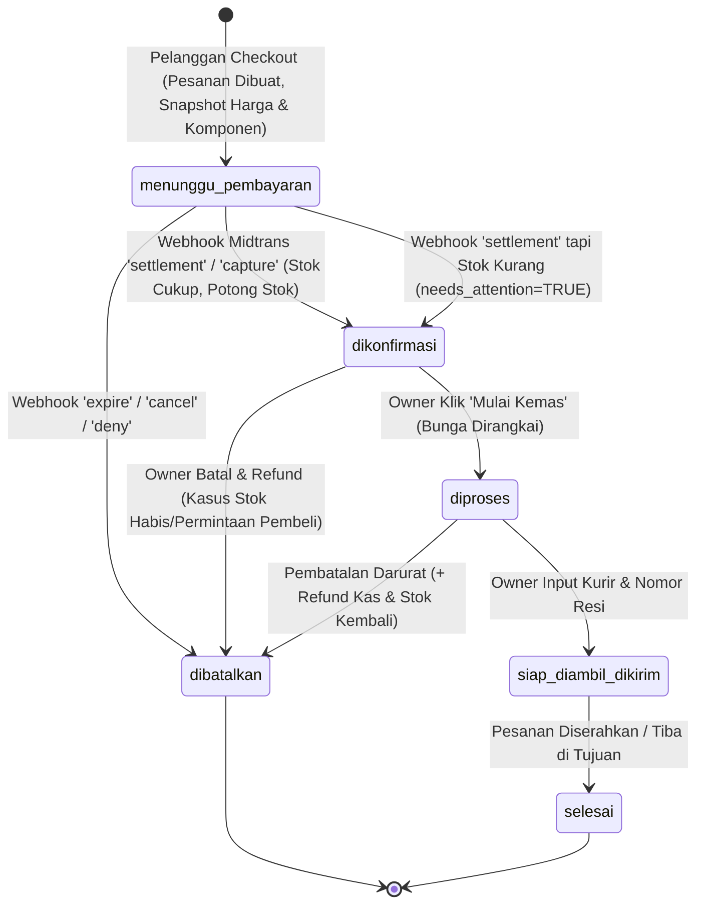

# 📋 MASTER PROJECT PLAN v3.1: FLOVERARTS_ (STRATEGI BACKEND-FIRST & EARLY DEMO-READY)

> [!IMPORTANT]
> **Parameter Kalender, Jam Kerja, & Mitigasi Risiko Presentasi:**
> - **Total Waktu Pelaksanaan:** **21 Hari Kalender Berturut-turut** (Jumat, 23 Oktober 2026 – Kamis, 12 November 2026).
> - **Klasifikasi Hari:** Menggunakan **21 Hari Kalender** (termasuk 3 kali akhir pekan: 24–25 Okt, 31 Okt–1 Nov, 7–8 Nov). Komitmen kerja terfokus: **5–6 jam/hari**.
> - **Strategi Inti:** **"Backend Dulu Sampai Tuntas, Dilanjutkan Frontend Pelanggan Awal untuk Demo Cepat"**.
> - **⚠️ MITIGASI RISIKO JADWAL PRESENTASI (Rentang 2–8 November 2026 / Status: `TBD`):**
>   Alur belanja pelanggan siap didemokan pada **Hari 10 (Minggu, 1 November 2026)** dan seluruh MVP (Pelanggan + Admin) siap pada **Hari 17 (Minggu, 8 November 2026)**. Jika presentasi jatuh pada rentang **2–7 November 2026**, fitur admin didemokan melalui Postman Runner sambil menunggu antarmuka admin selesai. Tanggal presentasi wajib dikonfirmasi ke dosen sebelum Hari 1.
> - **Stack Teknologi Baku:** Node.js Express.js + `mysql2/promise` (Backend), React 18 + Vite (Frontend), MySQL 8.0 / MariaDB 10.4+ (Database), Midtrans Sandbox (Payment).

---

## 🎯 Target Milestone Progres (0% ➔ 100%)

---

## 🔄 Diagram Transisi 6 Status Baku Pesanan & Refund

---

## 📅 Rencana Kerja Harian (Day-by-Day Breakdown)

### 🔹 MINGGU 1: BACKEND INTI & TRANSAKSI TRANSAKSIONAL (Target: 0% ➔ 40%)
*Fokus: Membangun fondasi Express.js, MySQL Pool, otentikasi, katalog, keranjang belanja, checkout, dan pembayaran Midtrans berstandar enterprise.*

- [ ] **Hari 1 (Jum, 23 Okt) — Setup Express.js, MySQL Pool, & Eksekusi Skema v1.2**
  - **Fokus:**
    - Inisialisasi proyek Node.js Express di folder `/backend` dengan konfigurasi environment `.env`.
    - Setup driver `mysql2/promise` menggunakan Connection Pool (`waitForConnections: true`, `connectionLimit: 10`).
    - Standardized JSON Envelope: `{ success: true, data, message }` dan `{ success: false, error: { code, message, details } }`.
    - Global Error Handling & 404 Route Not Found Middleware.
    - Validasi koneksi database melalui endpoint `GET /api/health`.
    - Eksekusi basis data: File all-in-one [database.sql](file:///c:/floverarts_/database.sql) (atau kombinasi modular [schema.sql](file:///c:/floverarts_/schema.sql) dan [seed.sql](file:///c:/floverarts_/seed.sql)).
    - *Catatan Database:* Penggunaan `utf8mb4_unicode_ci` menjamin kompatibilitas baik pada MariaDB 10.4 (XAMPP lokal) maupun Managed MySQL 8.0 (Cloud).
  - **Postman:** Folder `01_System_Health`.
  - **Selesai Bila:** Endpoint `GET /api/health` mengembalikan HTTP 200 OK dengan status database `connected`, dan tabel-tabel di `floverarts_db` terverifikasi utuh.

- [ ] **Hari 2 (Sab, 24 Okt) — JWT Authentication, RBAC 2 Role, & Manajemen Profil**
  - **Fokus:**
    - Registrasi pelanggan (`POST /api/auth/register`) dengan hashing password Bcrypt (salt cost: 10).
    - Login (`POST /api/auth/login`) dengan penerbitan token JWT (`userId`, `role`, `email`).
    - Penolakan login eksplisit untuk akun berstatus `inactive` atau `suspended` (HTTP 403 Forbidden).
    - Middleware Keamanan: `verifyToken`, `requireRole('customer')`, dan `requireRole('owner_admin')`.
    - Logout endpoint (`POST /api/auth/logout`): Penghapusan token sesi client-side dan revokasi `refresh_tokens`.
    - Endpoint Profil Diri & Ganti Password: `GET /api/user/profile`, `PUT /api/user/profile`, `PUT /api/user/change-password` (verifikasi kecocokan password lama).
  - **Postman:** Folder `02_Auth` & `03_User_Profile`.
  - **Selesai Bila:** Token JWT terbit sesuai role, user nonaktif tertolak, dan endpoint ganti password berhasil memvalidasi kredensial lama.

- [ ] **Hari 3 (Min, 25 Okt) — Modul Kategori (Publik & Admin) & Katalog Produk**
  - **Fokus:**
    - Endpoint Kategori Publik: `GET /api/categories`.
    - Endpoint Kategori Admin: `POST`, `PUT`, `DELETE /api/admin/categories/:id` (wajib tolak hapus jika kategori masih dikaitkan dengan produk aktif, HTTP 400).
    - Endpoint Katalog Produk Publik: `GET /api/products` (mendukung filter kategori `?cat=slug/id` dan live search nama bunga `?q=`).
    - Endpoint Detail Produk: `GET /api/products/:slug` (hanya menampilkan produk aktif beserta stok aktual).
    - Endpoint CRUD Produk Admin: `POST /api/admin/products`, `PUT /api/admin/products/:id`, `DELETE /api/admin/products/:id` (penegakan *soft-delete* via `status='inactive'`).
  - **Postman:** Folder `04_Catalog_Public` & `05_Admin_Catalog`.
  - **Selesai Bila:** Admin dapat mengelola produk dan kategori; penghapusan kategori berelasi tertolak; katalog publik menyaring data secara presisi.

- [ ] **Hari 4 (Sen, 26 Okt) — Master Komponen Custom Bouquet & Keranjang Belanja**
  - **Fokus:**
    - Endpoint Master Komponen Custom: `GET /api/custom-components` (menyaring komponen aktif per kategori: bunga, wrapping, pita, kartu).
    - Inisialisasi Keranjang Belanja Pelanggan: `GET /api/cart` (mengembalikan rincian item reguler dan racikan custom bouquet beserta subtotal terkalkulasi).
    - Tambah Item ke Keranjang: `POST /api/cart/items` (menangani item produk reguler maupun paket buket racikan sendiri yang disimpan relasional ke tabel `cart_item_components`).
    - Modifikasi & Hapus Keranjang: `PATCH /api/cart/items/:id` (update kuantitas) dan `DELETE /api/cart/items/:id`.
  - **Postman:** Folder `06_Cart_Management` & `07_Custom_Bouquet_Master`.
  - **Selesai Bila:** Keranjang belanja mampu menampung produk tunggal dan buket rakitan dinamis lengkap dengan rincian komponennya.

- [ ] **Hari 5 (Sel, 27 Okt) — Engine Checkout, Snapshot Transaksi, & Riwayat Pesanan**
  - **Fokus:**
    - Endpoint Checkout Transaksional: `POST /api/orders/checkout`.
    - Validasi Data Checkout:
      1. Tanggal dan jam pengiriman tidak boleh di masa lampau (`delivery_date >= CURRENT_DATE`).
      2. Validasi format nomor HP Indonesia (`/^08[0-9]{8,12}$/`).
      3. Validasi pilihan metode pemenuhan: `fulfillment_method` ('delivery' / 'pickup').
    - Format Kode Pesanan Baku: `order_number` memakai format `ORD-YYYYMMDD-XXXX`.
    - Validasi ketersediaan stok fisik seluruh item keranjang di server (server-authoritative) tanpa memotong stok.
    - Snapshot data: Salin data produk ke `order_items` dan komponen buket ke `order_item_components` beserta snapshot harga satuan saat transaksi.
    - Penetapan status awal pesanan: `menunggu_pembayaran`.
    - Endpoint Riwayat & Tracking Pesanan Pelanggan: `GET /api/user/orders` dan `GET /api/user/orders/:id` (penegakan proteksi data: user dilarang mengakses order milik user lain, HTTP 403).
  - **Postman:** Folder `08_Checkout_Order` & `09_User_Orders_Tracking`.
  - **Selesai Bila:** Order berhasil dibuat dengan harga terkunci, keranjang terosongkan, validasi data kirim ketat, dan riwayat pesanan terproteksi antar-pelanggan.

- [ ] **Hari 6 (Rab, 28 Okt) — Midtrans Snap SDK, Mekanisme Bayar Ulang, & Webhook Inti**
  - **Fokus:**
    - Konfigurasi Midtrans SDK Sandbox (Server Key & Client Key).
    - Format Gateway ID Unik: `{order_number}-{percobaan}` (misal: `ORD-20261028-0001-1`, maksimal 50 karakter Midtrans) untuk mendukung bayar ulang (*retry payment*) jika sesi sebelumnya kedaluwarsa.
    - Endpoint Charge: `POST /api/payments/charge` menerbitkan Snap Token dari nominal `orders.total_amount`.
    - Setup Tunnel HTTPS Publik (Cloudflared Tunnel atau Ngrok) untuk meneruskan webhook Midtrans ke localhost.
    - Endpoint Webhook Inti: `POST /api/webhooks/midtrans`:
      1. Verifikasi Signature Key SHA512: `SHA512(order_id + status_code + gross_amount + server_key)`.
      2. Validasi nominal: `gross_amount == payments.amount`.
      3. Idempotensi Mutlak: `INSERT INTO payment_webhook_logs (event_key)` dan penanganan graceful jika terjadi duplicate error (MySQL Error 1062).
      4. Penguncian stok bebas deadlock: `ORDER BY id ASC FOR UPDATE`.
      5. Pemotongan stok otomatis saat notifikasi `settlement`/`capture`, pencatatan mutasi `inventory_transactions` ('out'), pencatatan kas `cashflow_transactions` (`source='order_sales'`), dan update order menjadi `dikonfirmasi`.
  - **Postman:** Folder `10_Midtrans_Payment_Charge` & `11_Midtrans_Webhook_Core`.
  - **Selesai Bila:** Webhook `settlement` berhasil memotong stok, mencatat kas masuk, dan memperbarui status order secara atomik dan idempotent.

- [ ] **Hari 7 (Kam, 29 Okt) — Webhook Edge-Cases & BUFFER REGRESI POSTMAN (Milestone 40%)**
  - **Fokus:**
    - Penanganan Webhook Edge-Cases:
      - Penjaga Notifikasi `expire`: Event expire dari percobaan bayar lama dilarang membatalkan pesanan yang sudah berstatus lunas.
      - SOP Penanganan Stok Habis: Jika stok fisik habis saat notifikasi bayar tiba, jangan buat status fiktif; tandai `orders.needs_attention = TRUE` dan simpan alasannya. Status tetap `dikonfirmasi` (dana sudah masuk).
      - Penanganan event `deny`, `cancel`, dan request token Snap baru pada order yang sama via gateway ID baru.
    - **BUFFER POSTMAN RUNNER:** Menjalankan seluruh koleksi Folder 01–11 secara otomatis via Postman Runner (**Target: 100% PASS**).
  - **Postman:** Folder 01 s.d. 11 Full Automated Test.
  - **Selesai Bila:** Seluruh skenario normal dan edge-case webhook lolos uji; seluruh endpoint pelanggan dan transaksi Backend 100% stabil.

---

### 🔹 MINGGU 2: FRONTEND PELANGGAN (DEMO CEPAT) & BACKEND ADMIN (Target: 40% ➔ 70%)
*Fokus: Mengintegrasikan antarmuka pelanggan agar web siap didemokan pada Hari 10, menyelesaikan API admin, dan mencapai Backend Freeze.*

- [ ] **Hari 8 (Jum, 30 Okt) — Frontend Pelanggan 1: Setup Vite, Routing, Auth, & Katalog**
  - **Fokus:**
    - Inisialisasi React 18 + Vite di folder `/frontend`, konfigurasi TailwindCSS & design system toko bunga estetik.
    - Setup Routing (`react-router-dom`), Layout Shell (Navbar responsif dengan keranjang badge, Footer elegan).
    - Setup Axios Instance: Request Interceptor (auto-attach `Authorization: Bearer <token>`) & Response Interceptor (auto-logout jika 401).
    - Setup Global State: `AuthContext` (login, logout, data profil user).
    - Halaman Login & Register terintegrasi API dengan validasi formulir dan pesan error responsif.
    - Halaman Katalog Bunga: Grid kartu buket, filter tab kategori, dan search input live debounced.
    - Halaman Detail Produk (`/produk/:slug`): Galeri foto, komposisi bunga, info sisa stok, dan tombol kuantitas.
  - **Selesai Bila:** Pengguna dapat mendaftar, login, menjelajahi katalog dengan data riil dari backend, dan melihat rincian produk.

- [ ] **Hari 9 (Sab, 31 Okt) — Frontend Pelanggan 2: Keranjang Belanja & Custom Bouquet Builder**
  - **Fokus:**
    - Setup `CartContext` untuk sinkronisasi item keranjang langsung ke backend API.
    - Drawer / Halaman Keranjang Belanja: Tampilan daftar item, kontrol tambah/kurang kuantitas, tombol hapus, dan rincian subtotal.
    - Halaman Interaktif Custom Bouquet Builder (Fitur Unggulan):
      - Step 1: Pemilihan Bunga Utama (Mawar, Lily, Matahari, Baby Breath).
      - Step 2: Pemilihan Kertas Wrapping (Hitam, Kraft, Pastel).
      - Step 3: Pemilihan Pita & Aksesori (Satin Gold, Lampu LED).
      - Step 4: Kartu Ucapan khusus.
      - Komponen Live Price Calculator: Kalkulasi harga dinamis di layar saat komponen dipilih.
      - Tombol "Masukkan Buket ke Keranjang" (mengirim payload komponen terstruktur ke API).
  - **Selesai Bila:** Pelanggan berhasil merakit buket bunga custom di browser, melihat perubahan harga secara real-time, dan menyimpannya ke keranjang.

- [ ] **Hari 10 (Min, 01 Nov) — Frontend Pelanggan 3: Checkout, Snap Popup, & 🎯 DEMO ALUR PELANGGAN SIAP!**
  - **Fokus:**
    - Halaman Checkout Form: Input data penerima, alamat pengiriman lengkap, pemilihan tanggal & jam pengiriman, dan catatan pesanan.
    - Integrasi Midtrans Snap Embed (script Snap.js di React): Memunculkan modal popup pembayaran saat submit checkout.
    - Handling callback pembayaran Snap: `onSuccess`, `onPending`, `onError`, `onClose`.
    - Halaman Riwayat Transaksi Pelanggan: Daftar invoice dan status pembayaran.
    - Halaman Tracking Pesanan: Visual stepper 6 status pengerjaan buket bunga, info nama kurir, dan nomor resi pengiriman.
    - **🎯 MILESTONE DEMO ALUR BELANJA PELANGGAN SIAP:**
      Alur belanja dari memilih bunga hingga pembayaran Midtrans Snap dan pelacakan pesanan **100% berfungsi visual di browser**. Jika presentasi ujian diadakan pada 2–7 November, aplikasi sudah siap didemokan di layar!
  - **Selesai Bila:** Pelanggan dapat menyelesaikan transaksi dari katalog hingga nota digital tanpa error konsol.

- [ ] **Hari 11 (Sen, 02 Nov) — Backend Admin 1: Status Pesanan, Cek Gateway, & Alur Refund**
  - **Fokus:**
    - Endpoint Transisi Status Pesanan Toko: `PATCH /api/admin/orders/:id/status` (validasi state machine 6 status: `diproses` [kemas], `siap_diambil_dikirim` [+ input nama kurir & no resi], `selesai`).
    - Endpoint Cek Gateway Paksa: `POST /api/admin/orders/:id/check-gateway` (sinkronisasi status langsung ke REST API Midtrans jika webhook terhambat).
    - Endpoint Pembatalan & Refund Toko: `POST /api/admin/orders/:id/refund` (kembalikan kuantitas stok fisik `inventory_transactions.type='in'`, catat pengeluaran kas `cashflow_transactions.source='refund'`, potong saldo kas akun terkait).
  - **Postman:** Folder `12_Admin_Orders_Fulfillment` & `13_Admin_Refund`.
  - **Selesai Bila:** Owner dapat menggerakkan siklus hidup pesanan; refund mengembalikan stok dan saldo kas dengan audit transaksional rapi.

- [ ] **Hari 12 (Sel, 03 Nov) — Backend Admin 2: Stok, Cashflow, Akun Kas, Rekap CSV, & Dashboard**
  - **Fokus:**
    - Endpoint Restock Manual Toko: `POST /api/admin/inventory/restock` (menambah stok fisik dengan log mutasi masuk).
    - Endpoint Rekomendasi Restock / Alert: `GET /api/admin/inventory/low-stock` (`stock <= min_stock`).
    - Endpoint Pemantauan Arus Kas: `GET /api/admin/cashflow` (filter tipe: pemasukan / pengeluaran).
    - Endpoint Pengeluaran Toko: `POST /api/admin/cashflow/expense` (wajib memvalidasi saldo akun kas tidak boleh negatif/defisit; tolak HTTP 422 jika nominal > saldo).
    - Endpoint Akun Kas Toko: `CRUD /api/admin/cash-accounts` (larangan hard-delete akun kas yang berelasi).
    - Endpoint Rekapitulasi Kas & Ekspor CSV: `GET /api/admin/reports/recap` dan `GET /api/admin/reports/export-csv`.
    - Endpoint Agregasi Dashboard Owner: `GET /api/admin/dashboard` (omzet penjualan, pesanan aktif, ringkasan kas, dan alert stok).
  - **Postman:** Folder `14_Admin_Inventory` & `15_Admin_Finance_Dashboard`.
  - **Selesai Bila:** Pengeluaran kas defisit berhasil ditolak; file rekap CSV terunduh; metrik dashboard konsisten dengan basis data.

- [ ] **Hari 13 (Rab, 04 Nov) — 🎯 MILESTONE BACKEND FREEZE (65%) & Postman Full Regression**
  - **Fokus:**
    - **BACKEND FREEZE:** Eksekusi otomatis seluruh koleksi Postman (Folder 01 s.d. 15) menggunakan Postman Collection Runner (**Target: 100% PASS**).
    - Pembuatan dokumentasi kontrak respons API (contoh JSON sukses dan error) untuk acuan pengembangan Frontend Admin.
    - Backup snapshot database terkini (`floverarts_db_be_freeze.sql`).
  - **Postman:** Full Suite Runner 15 Folder PASS (Zero Failures).
  - **Selesai Bila:** Seluruh 15 folder Postman lolos uji; backend dikunci resmi tanpa ada penambahan skema baru lagi.

- [ ] **Hari 14 (Kam, 05 Nov) — BUFFER PAGI & Frontend Admin 1: Shell Admin & Produk/Kategori**
  - **Fokus (Pagi):** BUFFER penstabilan bug atau persiapan gladi bersih jika dosen menjadwalkan presentasi dadakan.
  - **Fokus (Sore):**
    - Layout Admin: Sidebar navigasi, Header Admin, Route Guard khusus role `owner_admin` (redirect jika bukan admin).
    - Halaman Manajemen Katalog Admin: Tabel produk dengan filter kategori, modal formulir tambah/edit produk (upload foto/URL gambar), dan toggle ubah status produk (aktif/nonaktif).
    - Halaman Manajemen Kategori: Tambah/edit kategori dengan penanganan error validasi jika kategori berelasi.
  - **Selesai Bila:** Admin dapat login dan mengelola data master produk serta kategori bunga secara visual dari browser.

---

### 🔹 MINGGU 3: FRONTEND ADMIN, TESTING MENYELURUH, CLOUD & RILIS (Target: 70% ➔ 100%)
*Fokus: Menyelesaikan sisa modul admin, gladi bersih demo menyeluruh, deployment cloud produksi, pengujian E2E, dan serah terima.*

- [ ] **Hari 15 (Jum, 06 Nov) — Frontend Admin 2: Manajemen Pesanan, Fulfillment, & Refund**
  - **Fokus:**
    - Halaman Manajemen Pesanan Toko: Tabel daftar pesanan masuk dengan badge 6 status baku.
    - Modal Rincian Pengerjaan: Menampilkan daftar komposisi buket (termasuk rincian racikan custom) dan teks kartu ucapan pelanggan.
    - Tombol Aksi Status: Tombol "Mulai Kemas", modal input "Nama Kurir & Nomor Resi Pengiriman", dan tombol "Selesaikan Pesanan".
    - Tombol Darurat "Cek Status ke Gateway": Sinkronisasi status instan server-to-server jika webhook terlambat.
    - Tombol "Batal & Refund Pesanan": Menjalankan alur refund dengan modal konfirmasi keamanan.
  - **Selesai Bila:** Siklus pemenuhan pesanan toko (fulfillment) dapat dikendalikan penuh oleh Admin dari antarmuka web.

- [ ] **Hari 16 (Sab, 07 Nov) — Frontend Admin 3: Stok Inventaris, Cashflow Keuangan, & Dashboard**
  - **Fokus:**
    - Halaman Manajemen Inventaris Admin: Form input restock stok bunga masuk dan tabel riwayat mutasi barang.
    - Halaman Arus Kas (Cashflow): Tabel transaksi masuk/keluar, modal input pengeluaran toko, dan tombol ekspor laporan CSV.
    - Halaman Akun Kas: Ringkasan saldo kas toko (Kasir, Bank BCA, Midtrans Escrow).
    - Halaman Dashboard Overview: Kartu metrik omzet penjualan, counter pesanan baru, dan widget alert stok bunga menipis.
    - Halaman Profil Owner & Ganti Password Admin.
  - **Selesai Bila:** Seluruh modul operasional admin tuntas dan terhubung 100% ke endpoint backend.

- [ ] **Hari 17 (Min, 08 Nov) — 🎯 MILESTONE DEMO-READY MVP PENUH (90%)**
  - **Fokus:**
    - **GLADI BERSIH DEMO-READY MVP:** Simulasi alur penuh presentasi:
      1. Pelanggan registrasi & belanja buket reguler + buket custom.
      2. Checkout & simulasi pembayaran lunas via Midtrans Sandbox Simulator.
      3. Owner memantau order masuk di dashboard, memproses rangkaian bunga, menginput resi kurir, dan menyelesaikan pesanan.
      4. Owner mengecek pemotongan stok otomatis dan penambahan kas masuk.
      5. Simulasi kasus refund dan verifikasi stok kembali serta kas berkurang.
  - **Selesai Bila:** Seluruh 25 fitur SRS berfungsi visual dari browser; aplikasi 100% siap dipresentasikan di hadapan dosen penguji pada hari terakhir rentang waktu presentasi.

- [ ] **Hari 18 (Sen, 09 Nov) — Deployment Cloud Staging/Produksi (Milestone 96%)**
  - **Fokus:**
    - Deployment Database: Managed MySQL 8.0 live di Railway / Aiven, import database `database.sql`.
    - Deployment Backend: REST API Express.js live di Railway (direkomendasikan dibanding Render free-tier yang mengalami *cold start / sleep* yang dapat menunda webhook).
    - Deployment Frontend: React Vite live di Vercel / Netlify, konfigurasi `VITE_API_BASE_URL` mengarah ke URL backend cloud.
    - Konfigurasi Webhook Midtrans Production/Sandbox URL publik resmi HTTPS di dashboard Midtrans.
    - **Keamanan Cloud:** Nonaktifkan seed akun demo atau ganti password default `Password123!` dengan kredensial kuat sebelum server dibuka untuk publik!
  - **Selesai Bila:** Aplikasi FloverArts live di domain internet; webhook Midtrans berhasil menjangkau URL server cloud publik.

- [ ] **Hari 19 (Sel, 10 Nov) — 🛑 BUFFER QA E2E Komprehensif & Uji Responsif Mobile**
  - **Fokus:**
    - Pengujian End-to-End menyeluruh terhadap seluruh 25 butir spesifikasi SRS PDF.
    - Eksekusi 15 Folder Postman Collection Runner pada environment staging/cloud (**Target: 100% PASS**).
    - Uji responsivitas antarmuka pada berbagai ukuran viewport layar: Ponsel pintar (360px, 412px), Tablet (768px), dan Desktop (1280px+).
    - Uji penanganan error jaringan (offline / server timeout).
  - **Postman:** Seluruh 15 Folder Postman Runner PASS.
  - **Selesai Bila:** *Zero Blocker Bug*; seluruh fitur SRS terverifikasi valid di layar desktop maupun ponsel.

- [ ] **Hari 20 (Rab, 11 Nov) — 🛑 BUFFER Bugfix Final & Hardening Sistem (Milestone 98%)**
  - **Fokus:**
    - Hari cadangan (*buffer time*) khusus untuk perbaikan bug tak terduga hasil temuan QA Hari 19.
    - Hardening sistem: Sanitasi input, pencegahan XSS, optimasi query database, dan perapian log server.
    - Pembersihan data transaksi uji coba agar database kembali bersih sebelum serah terima.
  - **Selesai Bila:** Seluruh kendala teknis terselesaikan; performa aplikasi stabil dan cepat.

- [ ] **Hari 21 (Kam, 12 Nov) — Code Freeze, Dokumentasi, & Serah Terima Final (Milestone 100%)**
  - **Fokus:**
    - Penguncian kode sumber repositori (*Code Freeze* di Git main branch).
    - Verifikasi berkas panduan instalasi & pengoperasian lengkap (`README.md`).
    - Ekspor berkas Postman Collection & Environment JSON terbaru.
    - Penyerahan produk ke pemilik toko dan gladi kotor persiapan bahan presentasi/sidang.
  - **Selesai Bila:** Sistem 100% operasional, dokumentasi serah terima lengkap, **Aplikasi FloverArts Siap 100%!**

---

## 🛡️ Analisis Risiko & Strategi Mitigasi

| Kategori Risiko | Deskripsi Potensi Masalah | Dampak | Tindakan Pencegahan & Mitigasi Cepat |
|---|---|:---:|---|
| **Jadwal Presentasi TBD** | Tanggal sidang ditetapkan mendadak pada rentang 2–7 November 2026. | **Tinggi** | **Mitigasi v3.1:** Alur belanja pelanggan siap didemokan di browser pada **Hari 10 (1 Nov)**. Jika presentasi jatuh pada 2–7 Nov, fitur admin didemokan via Postman Runner sambil antarmuka admin diselesaikan. Seluruh MVP siap pada Hari 17 (8 Nov). Tanggal presentasi wajib dikonfirmasi ke dosen sebelum Hari 1. |
| **Koneksi Webhook Gagal** | Webhook Midtrans terhalang firewall kampus / localhost tidak bisa diakses saat demo. | **Tinggi** | **Jalur Ganda:** 1) Gunakan tunnel publik Cloudflared/Ngrok yang sudah diuji di H6; 2) Sediakan tombol cadangan **"Cek Status ke Gateway"** di dashboard admin untuk sinkronisasi paksa via GET Midtrans API. |
| **Deadlock & Race Condition Stok** | Banyak transaksi simultan pada buket bunga yang sama saat settlement. | **Sedang** | Kunci baris database secara berurutan menggunakan query `ORDER BY id ASC FOR UPDATE` di dalam transaksi database atomik (Hari 6). |
| **Inkompatibilitas MySQL 8 vs MariaDB XAMPP** | Collation atau fungsi JSON/CHECK berbeda antara MariaDB lokal (10.4) dan MySQL Cloud (8.0). | **Sedang** | Skema `database.sql` distandarkan menggunakan `utf8mb4_unicode_ci`. Disarankan menggunakan MySQL 8 via Docker untuk pengembangan lokal agar identik dengan server produksi dan menghindari kerusakan data XAMPP. |
| **Server Free-Tier Cold Start (Sleep)** | Backend di Render free tier mengalami *sleep*, sehingga webhook Midtrans timeout/terlewat. | **Sedang** | Gunakan **Railway** untuk backend Node.js (selalu aktif), atau pasang cron job ping liveness setiap 5 menit jika menggunakan platform dengan fitur sleep. |
| **Perubahan Format Skema di Tengah Jalan** | Skema database diubah saat frontend sedang dibuat, menyebabkan bug kontrak. | **Tinggi** | Terapkan aturan **Backend Freeze** di Hari 13. Dilarang mengubah skema DDL setelah Hari 13; seluruh perubahan wajib diverifikasi di Postman terlebih dahulu. |

---

## ❓ 3 Poin Keputusan Terbuka yang Diperbarui

1. **Konfirmasi Tanggal Pasti Presentasi (`Status: TBD`):** Mohon konfirmasi tanggal dan jam pasti jadwal presentasi dari dosen penguji hari ini. Konfirmasi ini menentukan kepastian eksekusi jadwal Minggu 2.
2. **Lingkungan Basis Data Lokal:** Apakah Anda akan tetap menggunakan XAMPP MariaDB 10.4, atau bersedia menjalankan container Docker MySQL 8.0 resmi agar 100% sama dengan cloud?
3. **Penyedia Hosting Backend:** Sesuai analisis mitigasi, kami menyarankan **Railway** daripada Render (tier gratis Render sering *sleep* dan menunda webhook). Apakah akun Railway sudah siap digunakan?
